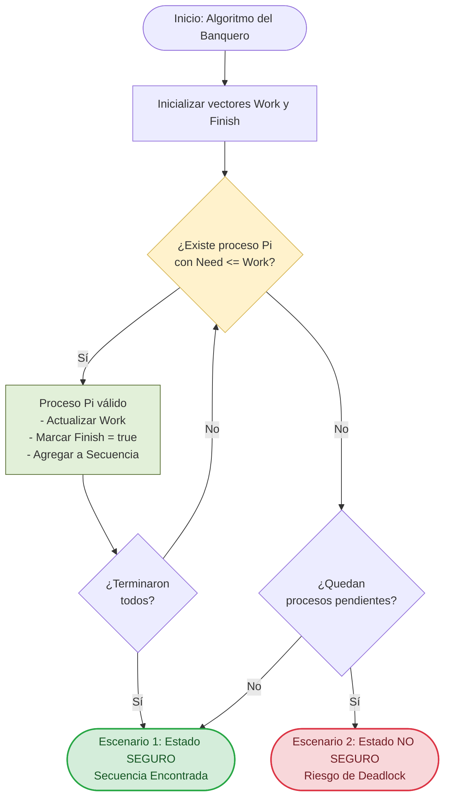

# Simulador del Algoritmo del Banquero 🏦

Este repositorio contiene una implementación interactiva en **Python** del **Algoritmo del Banquero**, desarrollada para la materia de **Sistemas Operativos**. El objetivo principal es simular la administración de recursos en un sistema operativo, demostrando cómo se previenen los interbloqueos (*deadlocks*) mediante la verificación constante de estados seguros e inseguros.

---

## 🧠 Explicación del Algoritmo

El **Algoritmo del Banquero**, diseñado por Edsger Dijkstra, es un algoritmo de control de concurrencia y evitación de interbloqueos. Simula la asignación de recursos limitados entre múltiples procesos, garantizando que el sistema nunca entre en una condición de bloqueo mutuo.

Para tomar decisiones, el algoritmo evalúa:
1. **Disponibles ($Available / Work$):** Cantidad de recursos de cada tipo que están libres en el sistema.
2. **Máximos ($Max$):** Demanda máxima declarada por cada proceso desde su inicio.
3. **Asignación ($Allocation$):** Recursos que actualmente tiene prestados cada proceso.
4. **Necesidad ($Need$):** Cantidad de recursos que aún requiere un proceso para finalizar ($Need = Max - Allocation$).

Un estado se considera **SEGURO** si existe al menos una orden de ejecución (secuencia segura) que permita que todos los procesos satisfagan su demanda máxima y terminen de ejecutarse. Si no existe tal secuencia, el sistema cae en un estado **INSEGURO** y rechaza las solicitudes de recursos para prevenir un interbloqueo.

---

## 📊 Diagrama de Flujo

El siguiente diagrama detalla la lógica interna para evaluar si el sistema se encuentra en un estado seguro o si cae en una condición de riesgo (estado inseguro):



---

## ⚙️ Funcionalidades del Simulador

El programa cuenta con un menú interactivo en consola que incluye:

1. **Escenario Exitoso (Estado Seguro):** 
   Carga una configuración predefinida de 5 procesos y 3 tipos de recursos para demostrar la búsqueda y hallazgo de una secuencia segura con trazas detalladas paso a paso.
2. **Escenario de Solicitud en Vivo (Petición Insegura):** 
   Simula la petición de recursos por parte de un proceso en tiempo de ejecución. Verifica los límites declarados, simula la entrega temporal de recursos y ejecuta el algoritmo de seguridad. En caso de riesgo, aplica un mecanismo de reversión (*rollback*).
3. **Modo Manual:** 
   Permite al usuario ingresar matrices personalizadas ($Max$, $Allocation$) y vectores ($Available$) para evaluar ejercicios específicos de clase.
4. **Validación de Errores:** 
   Control de excepciones en la entrada de datos por teclado.

---

## 🛠️ Requisitos e Instalación

### Requisitos previos
* **Python 3.x** instalado en el sistema.

### Ejecución
1. Clona o descarga este repositorio en tu equipo:
   ```bash
   git clone https://github.com/TU_USUARIO/TU_REPOSITORIO.git
   ```
2. Navega al directorio del proyecto:
   ```bash
   cd TU_REPOSITORIO
   ```
3. Ejecuta el script principal:
   ```bash
   python algoritmo_banquero_simulado.py
   ```

---

## 💻 Estructura del Código Fuente

* `calcular_necesidad(max_matriz, asignacion, n, m)`: Calcula la matriz de necesidad ($Need = Max - Allocation$).
* `es_estado_seguro_con_trazas(...)`: Algoritmo principal de prueba de seguridad. Muestra las iteraciones del vector $Work$ y marca los procesos terminados en $Finish$.
* `simular_solicitud(...)`: Implementa el algoritmo de petición de recursos, comprobando límites de seguridad y realizando *rollback* si la solicitud no es viable.
* `menu()`: Gestiona la interfaz por consola y la navegación del usuario.